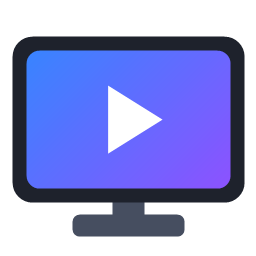
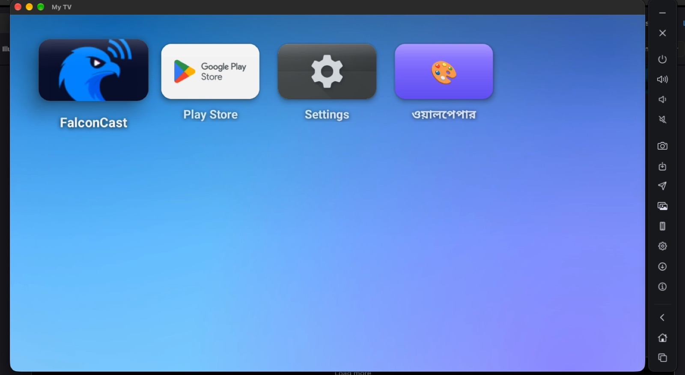
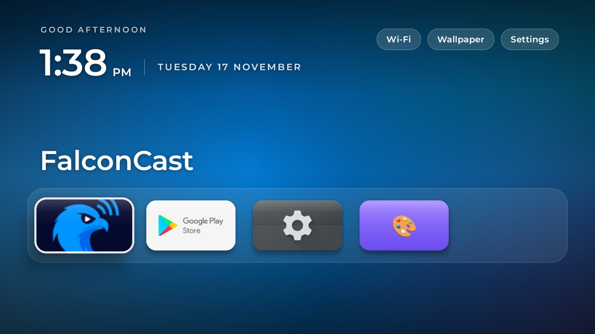
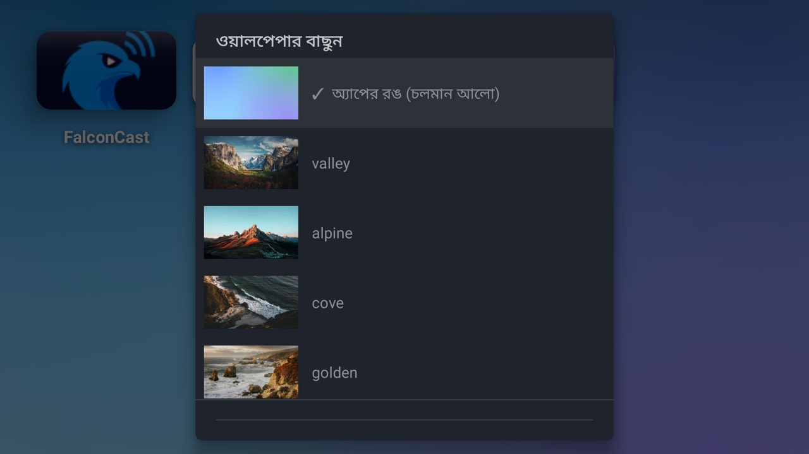

  

<h1 align="center">My TV</h1>

  কম্পিউটারেই নিজের Google TV — সুন্দর হোম স্ক্রিন, FalconCast সহ, এক ক্লিকে update।

  
  &nbsp;
  

  
  
  

  

## কী আছে

- **নিজের Google TV, কম্পিউটারের জানালায়** — মাউস, কীবোর্ড আর পাশে একটা গাঢ় সাইডবার: পাওয়ার, ভলিউম, স্ক্রিনশট, অ্যাপ ইনস্টল, ফাইল পাঠানো, Mobile view।
- **Lite Home** — হালকা আর দ্রুত হোম স্ক্রিন। বাছা অ্যাপের রঙে পেছনে নরম আলো, মাউস রাখলেই টাইল মসৃণভাবে বড় হয়।
- **FalconCast** আগে থেকেই বসানো।
- **মোবাইল রিমোট** — সাইডবারের রিমোট বোতামে QR কোড; ফোনের ক্যামেরায় স্ক্যান করলেই ফোন হয়ে যায় টিভির রিমোট (ভলিউম, চ্যানেল, উপর-নিচ, OK, লেখা পাঠানো)। কিছু install লাগে না, শুধু একই Wi-Fi।
- **নিজের ওয়ালপেপার** — কম্পিউটার থেকে যেকোনো ছবি সাইডবারের ওয়ালপেপার বোতামে, বা টিভির উপর টেনে ছেড়ে।
- **এক ক্লিকে update** — নতুন সংস্করণ এলে notification আসে, এক ক্লিকে update। টিভি চালুই থাকে।

  
  

## Download আর বসানো

### macOS (Apple Silicon ও Intel, macOS 13 বা নতুন)

1. **[MyTV-mac-1.0.2.zip](https://github.com/shakilnextive-beep/tv-tool-app/releases/download/mytv-v1.0.2/MyTV-mac-1.0.2.zip)** নামান (~২৯ MB), খুলুন, **My TV**-কে Applications-এ টেনে রাখুন।
2. প্রথমবার: **My TV-তে ডান-ক্লিক → Open → Open** (না হলে System Settings → Privacy & Security → **Open Anyway**)। My TV জিজ্ঞেস করলে **Applications ফোল্ডারে রাখুন**। (অ্যাপটা Apple-এর পেইড সার্টিফিকেটে সাইন করা নয়, তাই macOS একবার জিজ্ঞেস করে। পরে আর লাগে না।)
3. My TV Google-এর লাইসেন্স দেখাবে। রাজি হলে Google থেকে Android emulator আর Google TV (~১.২ GB) নামিয়ে টিভি বানাবে। ডিস্কে অন্তত ৬ GB খালি রাখুন।
4. প্রথম চালু হতে ১-২ মিনিট লাগে। তারপর থেকে আইকনে ক্লিক করলেই টিভি।

### Windows

শীঘ্রই আসছে।

## Update

My TV নিজেই নতুন সংস্করণ খোঁজে। এলে notification আসবে আর সাইডবারের ⬇︎ বোতাম নীল হবে। এক ক্লিকে update, টিভি চালু থাকে।
নিজে দেখতে চাইলে সাইডবারের ⬇︎ বোতাম চাপুন।

## মতামত আর পরামর্শ

আপনার মতামত খুব দরকারি।

- **রিভিউ বা পরামর্শ:** [Discussions](https://github.com/shakilnextive-beep/tv-tool-app/discussions) → New discussion
- **কোনো সমস্যা হলে:** [Issues](https://github.com/shakilnextive-beep/tv-tool-app/issues/new/choose) → "সমস্যা জানান"

## Creator

**Md. Shakil** · [shakil.nextive@gmail.com](mailto:shakil.nextive@gmail.com)

কৃতজ্ঞতা ও লাইসেন্স

- টিভির ছবি দেখায় [scrcpy](https://github.com/Genymobile/scrcpy) (Apache 2.0)।
- Android emulator আর Google TV ইমেজ Google-এর; প্রথম চালুর সময় আপনি নিজে Google-এর লাইসেন্সে রাজি হয়ে সরাসরি Google থেকে নামান।
- FalconCast তার নির্মাতার অনুমতিতে দেওয়া।
- ওয়ালপেপার ছবি: Unsplash।

---

# TV Tool — ফোন থেকে Android TV / Google TV সাজানো

ফোন থেকেই টিভি পরিষ্কার, দ্রুত আর নিজের মতো করে সাজান। কম্পিউটার লাগে না।
অ্যাপটা Wi‑Fi দিয়ে টিভির সাথে সরাসরি কথা বলে (ADB)।

**ডাউনলোড:** [Releases](https://github.com/shakilnextive-beep/tv-tool-app/releases/latest) → `TVTool-x.y.apk`

## যা করা যায়

- **ক্লিন-আপ:** বিজ্ঞাপন আর অদরকারি অ্যাপ বন্ধ করা (মুছে ফেলা নয়, যেকোনো সময় ফেরত আনা যায়)
- **হোম স্ক্রিন:** Depth Home লঞ্চার, ২৮টা থিম, depth ঘড়ি, আবহাওয়া
- **রিমোট:** D‑pad, ভলিউম, পাওয়ার, বাংলা টাইপ
- **ফাইল পাঠানো:** ফোন থেকে ছবি, ভিডিও, গান টিভিতে; APK ইনস্টল
- **টিভি দ্রুত:** অ্যানিমেশন কমানো, ক্যাশ পরিষ্কার, বিজ্ঞাপন আটকানো DNS
- **সব আগের মতো:** "আসল হোম ফেরত আনুন" আর "সব ফেরত আনুন" দিয়ে টিভি হুবহু আগের অবস্থায়

## শুরু করা

1. টিভিতে **Developer options** চালু করুন: Settings → System → About → **Android TV OS build**-এ ৭ বার OK চাপুন।
2. Settings → System → Developer options → **USB debugging** চালু করুন।
3. ফোন আর টিভি একই Wi‑Fi-তে রাখুন। APK ইনস্টল করে অ্যাপ খুলুন (ফোন "অজানা উৎস" অনুমতি চাইলে দিন)।
4. **নেটওয়ার্কে খুঁজুন** চেপে টিভি বাছুন, অথবা টিভির IP লিখে **সংযোগ করুন**।
5. টিভিতে "Allow USB debugging?" এলে **Always allow** টিক দিয়ে **Allow** চাপুন।

## আপডেট

অ্যাপের "টিভি তথ্য ও গতি" ট্যাবে **আপডেট আছে কিনা দেখুন** চাপুন। নতুন ভার্সন থাকলে এখান থেকে নামানো যাবে।
নতুন APK পুরোনোটার উপরেই ইনস্টল হয়, সেটিং থেকে যায়।

## সতর্কতা

এটা অফিসিয়াল কোনো অ্যাপ নয়। টিভির সিস্টেম অ্যাপ বন্ধ করার আগে অ্যাপ নিজেই ব্যাকআপ রাখে, আর জরুরি অ্যাপ
(যেমন সেটআপ, সেটিংস) বন্ধ করতে দেয় না। তবুও নিজের দায়িত্বে ব্যবহার করুন।

কৃতজ্ঞতা: [dadb](https://github.com/mobile-dev-inc/dadb) (Apache 2.0), cleanyourtv লঞ্চার (MIT), OFL ফন্ট, Fluent Emoji আইকন।
